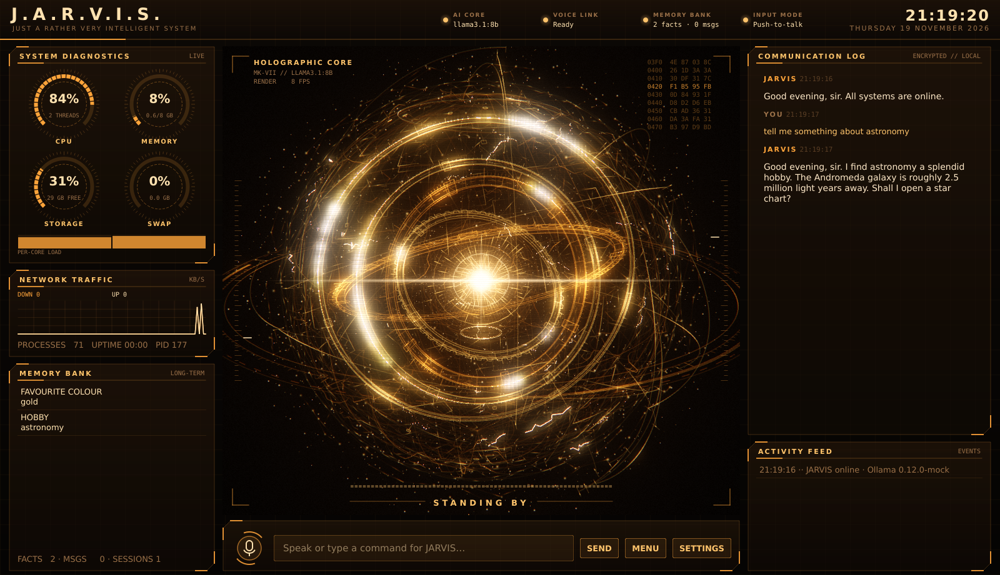
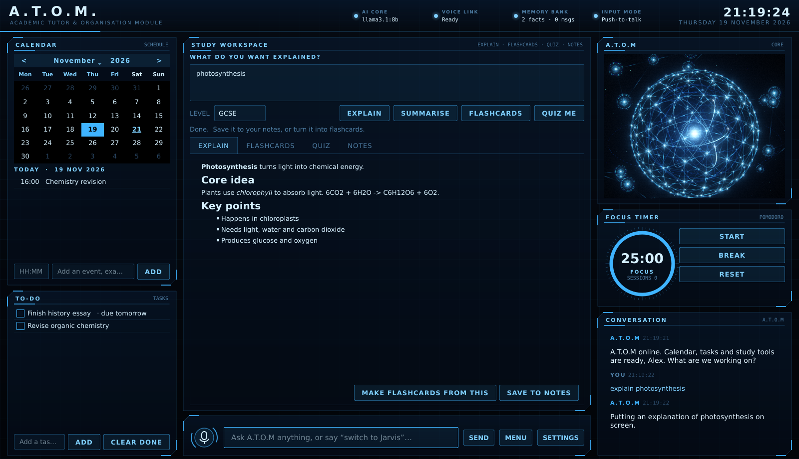
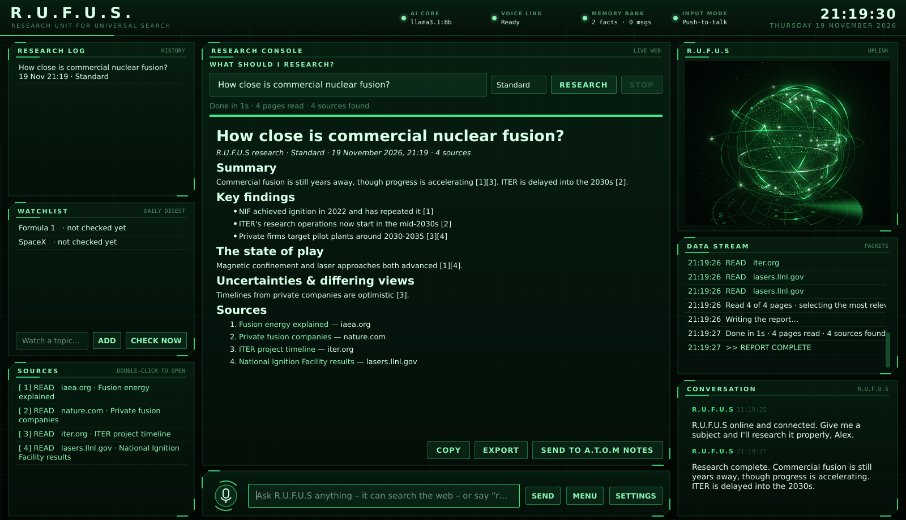

# J.A.R.V.I.S. — Personal AI System for Windows

A futuristic desktop AI assistant with three agents and real-time, GPU-rendered holograms.
The core runs **locally and for free**: the language model (Ollama), speech recognition (faster-whisper),
speech output (Windows voices / Piper) and long-term memory (SQLite).

| JARVIS — general assistant | A.T.O.M — work & revision | R.U.F.U.S — internet research |
|---|---|---|
|  |  |  |

<sub>Screenshots captured on a machine without a graphics card (software rendering), hence the low FPS readout.</sub>

Minimise it and it condenses to a floating hologram above your other apps:

| | | |
|---|---|---|
|  |  |  |

---

## Features

| Area | What you get |
|---|---|
| **Holographic core** | OpenGL 3.3 renderer (QOpenGLWidget + GLSL): five independently gimballed mechanical gyroscope rings (plates, struts, cog teeth, tick marks, moving illuminated sections), a central reactor (6 counter-rotating dashed rings, turbine mechanism, 72 pulsing radial spokes, horizontal energy scanner, pulsing light core with lens streaks), and an outer sphere (lat/long + geodesic wireframes, plexus network, energy filaments, circuit traces, flickering electrical arcs, orbital HUD rings, ~4,000 particles). HDR rendering, MSAA, 3-level bloom, filmic grading, depth fading. Drag to orbit, scroll to zoom, double-click to reset. |
| **Reacts to JARVIS** | Idle / listening / thinking / speaking / error / offline states change speed, energy, colour and core intensity. The core pulses with microphone level and speech output. |
| **Conversation** | Streaming answers from a local Ollama model, spoken sentence by sentence as they are generated. Interrupt at any time with **Esc**. |
| **Voice input** | faster-whisper (CTranslate2 + PyAV) with adaptive voice-activity detection. Push-to-talk (**Ctrl+Space** / **F2** / mic button) or **hands-free** mode with the wake word "Jarvis". |
| **Voice output** | Windows' built-in voices, rendered by JARVIS so each agent has its own voice, speed and optional depth, with real-time levels driving the hologram and automatic skipping of voices that don't work. Optional **Piper** neural voices. |
| **Long-term memory** | SQLite database with full conversation history (full-text search recall of relevant past exchanges), facts and preferences. JARVIS learns facts automatically, or on request ("remember that…"). |
| **Protocols** | Named step sequences ("Activate House Party protocol") with a built-in editor. |
| **Desktop control** | Open/close apps (Start-menu search), websites, web/YouTube/Wikipedia/Maps search, folders, volume, media keys, screenshots, timers & reminders, system diagnostics, lock, and shutdown/restart/sleep (with confirmation). Common commands run instantly without the LLM; anything else is handled by the model through native tool calling. |
| **A.T.O.M** | A second, blue assistant for work and revision: calendar, to-do list, explanations, flashcards, quizzes, notes and a focus timer. |
| **R.U.F.U.S** | A third, green agent that researches the internet and writes cited reports, with a live data-globe hologram. |
| **Mini hologram** | Minimise and JARVIS condenses to a frameless floating hologram above your other apps. |
| **Dashboard** | Live CPU / RAM / storage / battery gauges, per-core load, network traffic graph, memory bank, communication log, activity feed, status chips, clock. |

---

## Requirements

* Windows 10/11, 64-bit
* **Python 3.12 (64-bit)** — <https://www.python.org/downloads/> (tick *Add python.exe to PATH*)
* **Ollama** — <https://ollama.com/download> (the installer can install it for you through winget)
* 8 GB RAM minimum (16 GB recommended for 7–8B models)
* A GPU/driver with OpenGL 3.3 (any GPU from the last decade, including Intel integrated)
* A microphone and speakers for voice

## Installation (recommended)

Get the code with **Code › Download ZIP** on GitHub (or `git clone`), then:


1. Put the project folder somewhere permanent, e.g. `C:\JARVIS` (outside OneDrive is best).
2. Double-click **`install.bat`**. It will:
   * create a private virtual environment (`.venv`) and install all Python packages,
   * offer to install Ollama (via winget) and download a language model,
   * pre-download the speech-recognition model,
   * create a **JARVIS** shortcut on your desktop.
3. Launch JARVIS with the desktop shortcut or **`run.bat`**.

Use **`run_debug.bat`** if something goes wrong — it shows the log in a console window.

### Manual installation

```bat
cd C:\JARVIS
py -3.12 -m venv .venv
.venv\Scripts\activate
pip install -r requirements.txt
ollama pull llama3.1:8b
python main.py
```

### Choosing a model

Any Ollama chat model works. Models with **tool calling** let JARVIS act on free-form requests
("could you get Spotify going and turn it down a bit"):

| Model | Size | Notes |
|---|---|---|
| `llama3.1:8b` | 4.9 GB | Default. Good all-rounder with tool calling. |
| `qwen2.5:7b` | 4.7 GB | Excellent instruction following and tool use. |
| `qwen3:8b` | 5.2 GB | Strong reasoning; `<think>` output is filtered out automatically. |
| `llama3.2:3b` | 2.0 GB | Fast on low-end PCs. |

`ollama pull <model>`, then pick it in **Settings › AI Core**. Models without tool support still work —
JARVIS falls back to its built-in command router automatically.

---

## Using JARVIS

| Action | How |
|---|---|
| Talk | Click the mic, or press **Ctrl+Space** / **F2**, then speak. It stops when you pause. |
| Hands-free | Toggle **HANDS-FREE**, then say *"Jarvis, …"*. After it replies you have a few seconds to follow up without the wake word. |
| Type | Type in the command line and press Enter. |
| Interrupt | **Esc** stops speech and generation. |
| New session | **Ctrl+N** (long-term memory is kept). |
| Settings | **Ctrl+,** or the **SETTINGS** button. |
| Fullscreen | **F11**. |
| Mini hologram | Minimise, or **Ctrl+M**. Double-click the hologram to restore. |

### A.T.O.M — work & revision mode

A second assistant, **A.T.O.M** (Academic Tutor & Organisation Module), lives in the same app with its own
blue dashboard, hologram (a geodesic network of glowing nodes) and voice.

* Switch: *"Jarvis, switch to Atom"* / *"Atom, switch to Jarvis"* (also *"work mode"*, *"revision mode"*),
  the **A.T.O.M** / **JARVIS** buttons, or **Ctrl+J**. Either name works as a hands-free wake word.
* **Calendar**: click a day, add events, exams and deadlines; days with events are highlighted.
  Voice: *"What's on my calendar this week?"*, or ask A.T.O.M to *"add my chemistry exam on Friday at 9:30"*.
* **To-do list**: tick items off; *"add revise chemistry to my to-do list"*, *"tick off revise chemistry"*.
* **Study workspace**: type what you want explained, choose a level (Simple, GCSE, A-Level, University,
  Expert) and press **EXPLAIN**, **SUMMARISE** (paste your notes), **FLASHCARDS** or **QUIZ ME**.
  By voice: *"explain integration by parts"*, *"make flashcards on the French Revolution"*, *"quiz me on cell biology"*.
  Explanations can be saved to **NOTES** (auto-saved to `%APPDATA%\JARVIS\notes.md`).
* **Focus timer**: pomodoro timer; *"start a focus session"* or *"start a pomodoro for 50 minutes"*.
  A.T.O.M tells you when it's time for a break.

JARVIS and A.T.O.M share long-term memory about you, but keep separate conversation histories.
A.T.O.M's voice, speaking rate and timer lengths are in **Settings › A.T.O.M**.

### R.U.F.U.S — internet research

**R.U.F.U.S** (Research Unit For Universal Search) is the green agent and the **only one that goes online**.

* Switch: *"Jarvis, switch to Rufus"*, *"research mode"*, the menu buttons, or **Ctrl+J** (cycles all three agents).
* **Research console**: type a question, pick a depth and press **RESEARCH** (or say *"Rufus, research …"*).
  R.U.F.U.S plans several searches, searches the web (DuckDuckGo and other engines via the free `ddgs` package,
  plus Wikipedia), reads the best pages in parallel, picks the most relevant passages and has your local model
  write a report with numbered citations and a source list.

  | Depth | Searches | Pages read | Typical time |
  |---|---|---|---|
  | Quick | 1 | ~4 | 20–40 s |
  | Standard | 3 | ~8 | 40–90 s |
  | Deep | 5 | ~14 | 1–3 min |

* Live **data stream** and **sources** panels show what is being searched and read; double-click a source to open it.
* Reports are saved in the **research log**; **COPY**, **EXPORT** (Markdown, to `Documents\JARVIS Research`)
  or **SEND TO A.T.O.M NOTES**.
* In conversation R.U.F.U.S can also do quick web lookups (*"what's the latest on the Artemis missions?"*).
* Settings › R.U.F.U.S: search region, default depth, voice, or point it at your own SearXNG server.

**Watchlist.** Follow topics and get a digest of new stories: *"Rufus, watch SpaceX"*, *"keep an eye on Formula 1"*,
*"stop watching SpaceX"*, *"what's new on my watchlist?"*, or use the **Watchlist** panel (ADD / CHECK NOW, right-click
to remove). Only stories R.U.F.U.S hasn't shown you before are included, each topic gets a short summary, and digests
are saved in the research log. A digest runs automatically once a day (after 08:00 by default; Settings › R.U.F.U.S).

Search engines may occasionally rate-limit; if a search fails, wait a minute and try again.

### Morning briefing

Say *"morning briefing"*, *"brief me"* or *"good morning"*, or press **MENU › BRIEFING**. JARVIS runs through the
time and date, today's calendar, tasks due, any system warnings, new stories on your watchlist and the day's tech
headlines (spoken as a short summary, with clickable headlines in the chat). It also runs automatically on the
first start of the day before noon. The news parts use the internet via R.U.F.U.S's search; turn them off, change
the news topic, or disable the automatic briefing in **Settings › General**.

### Command bar

Every agent has the same bar: microphone, command box, **SEND**, **MENU** and **SETTINGS**.
**MENU** slides open a row with HANDS-FREE, VOICE, the other agents and PROTOCOLS. Keyboard shortcuts are listed
in **Settings › General**.

### Mini hologram

Minimise JARVIS (or press **Ctrl+M**) and the dashboard disappears: only the hologram stays, floating on top
of your other apps with no window, frame or buttons around it. It keeps reacting while JARVIS listens and speaks.

| Action | Mini hologram |
|---|---|
| Hover over the centre | A microphone button appears – click it to talk |
| Double-click | Restore the full dashboard |
| Drag | Move it (position is remembered) |
| Mouse wheel | Resize |
| Right-click | Talk / Restore / Size / Quit |

Turn it off in **Settings › Display** if you prefer a normal minimise.

### Built-in commands (instant, no LLM needed)

* *"Open notepad / Spotify / Chrome / settings / my downloads folder / github.com"*
* *"Close notepad"*
* *"Search for best pizza near me"*, *"Play lofi beats on YouTube"*, *"Look up Nikola Tesla on Wikipedia"*
* *"Volume up"*, *"Turn the volume down by 30 percent"*, *"Mute"*
* *"Pause the music"*, *"Next track"*
* *"Set a timer for 10 minutes for the pasta"*, *"Remind me in 1 hour to call mum"*
* *"Take a screenshot"* (saved to `Pictures\JARVIS`)
* *"System status"*, *"What time is it?"*
* *"Lock the computer"*, *"Shut down the computer"* (asks for confirmation)
* *"Remember that my favourite colour is gold"*, *"Forget my favourite colour"*, *"What do you remember about me?"*

Anything else goes to the language model, which can still call these tools itself.

### Protocols

A protocol is a named list of steps JARVIS carries out when you say **"Activate _name_ protocol"**
(also *initiate / engage / execute / run*). Open the editor with the **PROTOCOLS** button or **Ctrl+P**.
Four examples are included: **Focus**, **House Party**, **Diagnostics** and **Goodnight**.

One step per line:

| Step | Example |
|---|---|
| Speak a line | `say Welcome home, {title}.` |
| Pause | `wait 3 seconds` |
| Ask the AI and speak the answer | `ask give me a motivational quote` |
| Any built-in command | `open spotify`, `play`, `stop the music`, `volume up by 20`, `set a timer for 25 minutes`, `open github.com`, `system status`, `lock the computer` |

The editor checks every line as you type (OK = recognised, NO = not recognised) and has a **RUN NOW** button.
Also: *"What protocols do you have?"* and *"Abort protocol"* (or press **Esc**). Shutdown/restart steps
still ask you to confirm. Protocols are stored in `%APPDATA%\JARVIS\protocols.json`.
Note that `play` and `pause` press the same play/pause key, so use `stop the music` to make sure music stops.

### Memory

* All conversations are stored in `%APPDATA%\JARVIS\memory.db`.
* Each request includes recent messages, everything in the **memory bank**, and the most relevant
  excerpts from older conversations (SQLite FTS5 search).
* With *auto-learn* enabled (default), JARVIS extracts lasting facts about you in the background.
* Right-click an item in the Memory Bank panel to delete it; **Settings › Memory** clears everything.

---

## Voices

Each agent has its own voice, speed and **voice depth** (Settings › Voice, › A.T.O.M, › R.U.F.U.S;
100% = natural, the default; lower = deeper). If Windows lists a voice that
doesn't actually produce sound, JARVIS skips it automatically and uses the next best one.

**Better Windows voices:** *Settings › Time & language › Speech › Add voices* → add **English (United Kingdom)**.
JARVIS automatically prefers *George* or *Ryan* if present. Choose any voice in **Settings › Voice**.

**Natural Piper voices (recommended, free, offline).** Piper is the neural voice engine used by Home Assistant,
maintained by the Open Home Foundation. JARVIS ships with one male voice per agent:

| Agent | Voice |
|---|---|
| JARVIS | `en_GB-alan-medium` – British male, calm and clear |
| A.T.O.M | `en_GB-northern_english_male-medium` – Northern English male, warm |
| R.U.F.U.S | `en_US-ryan-high` – American male, crisp |

1. `pip install -r requirements.txt` (installs `piper-tts`).
2. **Settings › Voice › DOWNLOAD 3 MALE VOICES** – or run `python get_voices.py`. About 60 MB from the official
   Piper voice library (huggingface.co/rhasspy/piper-voices); afterwards everything works offline.
3. Press **TEST VOICE**. Swap any agent's voice for another `.onnx` voice from the library in Settings.

To add a different engine, subclass `TTSEngine` in `jarvis/core/tts.py` and register it in `ENGINES`.

## Faster speech recognition on NVIDIA GPUs (optional)

Whisper runs on the CPU (`int8`) by default, which is fine for `base.en`/`small.en`.
For larger models on an NVIDIA GPU:

```bat
.venv\Scripts\pip install nvidia-cublas-cu12 nvidia-cudnn-cu12==9.*
```

then set **Compute device** to `cuda` (or leave `auto`) and choose e.g. `small.en` or `distil-large-v3`.
If CUDA fails to load JARVIS falls back to the CPU automatically.

---

## Performance

**Settings › PERFORMANCE** lists every speed-up with an on/off switch (all on by default):

* **Faster replies** – a stable instruction prefix Ollama can reuse, the action list only when a message
  looks like a command, fact-learning deferred until idle, and a compact 4096-token chat context.
* **Faster startup** – holograms built only when first shown, hologram geometry cached on disk, Whisper and
  voices preloaded in the background.
* **Smoother speech** – the next sentence is prepared while the current one plays, Windows-voice audio
  kept in memory, single-pass speech recognition and quicker end-of-speech detection.
* **Lower CPU when idle** – panels only redraw when something changes, hidden pages pause, efficient
  hologram drawing, 30 fps while another app is in front, a 30 fps floating hologram and lighter system monitoring.
* **Faster research** – parallel searches and an 8-second limit for slow pages.
* **Measurement** – startup, first-word, first-speech, transcription and research timings, shown on the
  Performance page and written to `jarvis.log`.

Items marked RESTART apply the next time JARVIS starts. For the biggest speed-up in replies, use a smaller
model such as `llama3.2:3b`.

## Configuration and files

| Path | Contents |
|---|---|
| `%APPDATA%\JARVIS\config.json` | All settings (editable in the Settings dialog) |
| `%APPDATA%\JARVIS\memory.db` | Conversations, facts and preferences |
| `%APPDATA%\JARVIS\protocols.json` | Your protocols |
| `%APPDATA%\JARVIS\jarvis.log` | Log file |
| `%USERPROFILE%\Pictures\JARVIS` | Screenshots |

## Project structure

```
main.py                     entry point
jarvis/app.py               Qt bootstrap, logging, OpenGL surface format
jarvis/config.py            persistent settings
jarvis/core/assistant.py    the brain: routing, LLM streaming + tool loop, memory, state machine
jarvis/core/llm.py          Ollama REST client (streaming, tools, JSON mode, auto-start)
jarvis/core/memory.py       SQLite long-term memory with FTS5 search
jarvis/core/stt.py          microphone capture, adaptive VAD, wake word, faster-whisper
jarvis/core/tts.py          pluggable speech engines (Windows voices, Piper) with per-agent depth
jarvis/core/tools.py        desktop control tools + instant command router
jarvis/core/protocols.py    protocols: storage, step parsing, triggers
jarvis/core/textutil.py     sentence chunking for streaming speech, markdown/think filtering
jarvis/ui/main_window.py    dashboard layout and wiring
jarvis/ui/widgets.py        HUD panels, gauges, graphs, chat log, mic button, hologram overlay
jarvis/ui/settings_dialog.py
jarvis/ui/mini_hologram.py  floating transparent mini hologram
jarvis/ui/lazy_hologram.py  builds a hologram the first time it's shown
jarvis/perf.py              performance switches and timing measurements
jarvis/ui/atom_dashboard.py A.T.O.M page;  atom_widgets.py: calendar, tasks, timer, workspace
jarvis/core/research.py     R.U.F.U.S: web search, page reading, passage ranking, cited reports
jarvis/ui/rufus_dashboard.py R.U.F.U.S page;  command_bar.py: shared bar with collapsible menu
jarvis/core/study.py        A.T.O.M prompts, dates, study intents, flashcard/quiz parsing
jarvis/ui/hologram/         renderer.py (pipeline + scene), geometry.py, shaders.py, glmath.py
```

### Adding a tool

In `jarvis/core/tools.py`, write a method on `ToolBox` that returns a short sentence, and register it
in `_register()` with a description and JSON-schema parameters. The model can call it immediately;
add a regex to `match_intent()` if you also want an instant voice command.

---

## Troubleshooting

| Problem | Fix |
|---|---|
| *"AI core offline"* | Start the Ollama app (or `ollama serve`). JARVIS also tries to start it automatically. |
| *"Model … not installed"* | `ollama pull llama3.1:8b`, or choose an installed model in Settings. |
| Hologram shows *"OpenGL 3.3 is required"* | Update your graphics driver. On remote desktop / VMs, OpenGL may be unavailable. |
| Low frame rate | Settings › Display › quality `medium` or `low`, then restart. |
| JARVIS doesn't hear me | Pick the right microphone in Settings › Voice, raise *Mic sensitivity*, and check Windows privacy settings allow desktop apps to use the microphone. |
| JARVIS hears itself | Use headphones, or lower the speaker volume; listening pauses while it speaks. |
| Slow first answer | The model is loading into memory; later answers are fast. JARVIS pre-loads it at startup. |
| `pip install` fails | Make sure you use **64-bit Python 3.12**. |

Logs: `%APPDATA%\JARVIS\jarvis.log`.

## Privacy

JARVIS and A.T.O.M never go online: conversations, audio and memory stay on your computer. **R.U.F.U.S is the
exception** – when you ask it to research or look something up it sends your search queries to search engines
(DuckDuckGo and others via `ddgs`, or your SearXNG server) and Wikipedia, and downloads the pages it reads. The
pages are processed and summarised by your local model; nothing else about you is sent. Opening websites or
searching "in the browser" from JARVIS uses your normal browser.

## Licence

JARVIS is free software released under the **GNU General Public License v3.0** – see [LICENSE](LICENSE).
It uses the GPL-licensed Piper voice engine (`piper-tts`) and other open-source packages listed in
`requirements.txt`, each under its own licence.

## Disclaimer

This is an independent fan-inspired project. It is not affiliated with, endorsed by or connected to
Marvel, Disney or any film studio. "J.A.R.V.I.S." is used here as the name of a personal software project.
